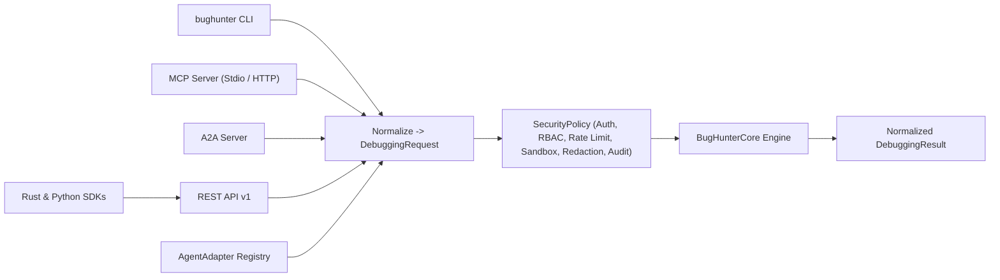

# BugHunter — Universal Debugging Integration Architecture

[](https://github.com/NOCORPS/bughunter/actions/workflows/ci.yml)
[](LICENSE)


BugHunter is an open, extensible, provider-independent, and agent-independent debugging infrastructure written in Rust, with a companion Python SDK and standardized protocol servers.

Every external interface—CLI, Model Context Protocol (MCP), Agent2Agent (A2A), REST API v1, Rust SDK, Python SDK, and Agent Adapters—normalizes incoming requests into a single internal `DebuggingRequest` and executes through `BugHunterCore` under one unified `SecurityPolicy`.

## Architecture Overview



### Core Principles

1. **Single Debugging Engine**: All integrations delegate to `BugHunterCore` ([engine.rs](crates/bughunter-core/src/engine.rs)). No debugging logic is duplicated in protocol layers.
2. **Provider Independence**: 15 built-in model provider adapters behind a unified `ModelProvider` trait with capability detection, retries, rate-limit handling, and graceful fallbacks.
3. **Agent Framework Independence**: Standardized MCP, A2A, and REST/HTTP interfaces plus `AgentAdapter` abstractions.
4. **Unified Security Controls**: Every integration enforces the same `SecurityPolicy` ([security.rs](crates/bughunter-core/src/security.rs))—authentication, RBAC permissions, rate limiting, sandbox path restrictions, secret redaction, and audit logging.
5. **Process-Isolated Plugins**: Third-party plugins run out-of-process via JSON-RPC over stdio (`SubprocessPluginRunner`), never inside the core process.

## Repository Layout

| Component | Path | Purpose |
| :--- | :--- | :--- |
| Core Engine & Security | [crates/bughunter-core](crates/bughunter-core/Cargo.toml) | `BugHunterCore`, `DebuggingRequest`/`DebuggingResult`, `SecurityPolicy`, `BugHunterError` |
| Model Providers | [crates/bughunter-providers](crates/bughunter-providers/Cargo.toml) | `ModelProvider` trait, OpenAI-compatible presets, Anthropic, Gemini, `ProviderRegistry` |
| Agent Adapters | [crates/bughunter-agents](crates/bughunter-agents/Cargo.toml) | `AgentAdapter` trait, `CoreBackedAgentAdapter`, `RemoteProtocolAgentAdapter`, `AgentRegistry` |
| MCP Server | [crates/bughunter-mcp](crates/bughunter-mcp/Cargo.toml) | MCP JSON-RPC 2.0 server over Stdio and Streamable HTTP (`POST /mcp`) |
| A2A Server | [crates/bughunter-a2a](crates/bughunter-a2a/Cargo.toml) | Agent Card (`/.well-known/agent.json`) and async A2A task endpoints |
| REST API v1 | [crates/bughunter-api](crates/bughunter-api/Cargo.toml) | Versioned `/api/v1/*` endpoints, OpenAPI 3.1 spec, and `unified_server_router` |
| Plugin System | [crates/bughunter-plugins](crates/bughunter-plugins/Cargo.toml) | `PluginManifest`, `PluginRegistry`, and out-of-process `SubprocessPluginRunner` |
| Rust SDK | [crates/bughunter-sdk](crates/bughunter-sdk/Cargo.toml) | Async `BugHunterClient` for the REST API v1 |
| CLI Binary | [crates/bughunter-cli](crates/bughunter-cli/Cargo.toml) | `bughunter` binary with human-readable and `--json` output |
| Python SDK | [sdk/python](sdk/python/pyproject.toml) | `BugHunterClient` & `AsyncBugHunterClient` (`bughunter_sdk`) |
| Agent Configs | [integrations](integrations/custom-mcp/README.md) | Ready-to-use MCP and CLI fallback guides for coding agents |

## Quick Start

### 1. Install in One Command

```bash
git clone https://github.com/NOCORPS/bughunter.git
cd bughunter
cargo install --path crates/bughunter-cli
```

*(Optional)* Install the zero-dependency Python SDK:

```bash
pip install ./sdk/python
```

### 2. Use Immediately (No External Keys Required)

```bash
# Run an end-to-end investigation on the current repo with JSON output
bughunter investigate --repository . --issue "Fix auth token validation" --verify --json

# Analyze any repository
bughunter analyze --repository . --json

# Start the unified server (REST API v1 + MCP HTTP + A2A + OpenAPI)
bughunter serve --addr 127.0.0.1:8080

# Or start as a local MCP stdio server for Claude Code / OpenCode / OpenClaw
bughunter mcp --transport stdio
```

> **No hosted account or API key is required for local use.** Local CLI commands and `bughunter mcp --transport stdio` work out of the box.
> If you expose `bughunter serve` over the network, generate your own token locally (for example, `export BUGHUNTER_API_TOKEN=$(openssl rand -hex 32)`) and pass `--token "$BUGHUNTER_API_TOKEN"`. Copy [.env.example](.env.example) to `.env` if you also want to configure external LLM provider keys (`OPENAI_API_KEY`, `ANTHROPIC_API_KEY`, `GEMINI_API_KEY`, etc.).

### Using `Makefile` Shortcuts

```bash
make install   # Install bughunter CLI + Python SDK
make test      # Run all Rust and Python SDK tests
make serve     # Start unified HTTP server on 127.0.0.1:8080
make mcp       # Start MCP stdio server
```

## Contributing & License

- Contributions welcome! See [CONTRIBUTING.md](CONTRIBUTING.md).
- Licensed under the [Apache License 2.0](LICENSE).

## Documentation

- [Architecture & Security](docs/architecture.md) — Core workflows, normalization, RBAC, rate limiting, sandboxing, and secret redaction.
- [Model Providers](docs/providers.md) — `ModelProvider` trait, all 15 built-in adapters, environment variables, retries, and fallbacks.
- [REST API, MCP & A2A](docs/api-and-protocols.md) — Endpoints, OpenAPI 3.1, MCP tools, and A2A task lifecycle.
- [CLI & SDKs](docs/cli-and-sdks.md) — Full CLI reference, Rust SDK, and Python SDK usage.
- [Plugins & Agent Integrations](docs/plugins-and-agents.md) — Out-of-process plugin protocol, `AgentAdapter`, and coding agent guides.

## Verification & Testing

Run the full Rust workspace test suite (unit + mock-server integration tests) and the Python SDK tests:

```bash
cargo test --workspace
PYTHONPATH=sdk/python python3 -m unittest discover -s sdk/python/tests -v
```
